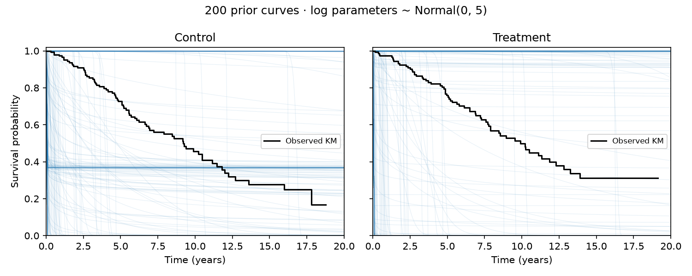
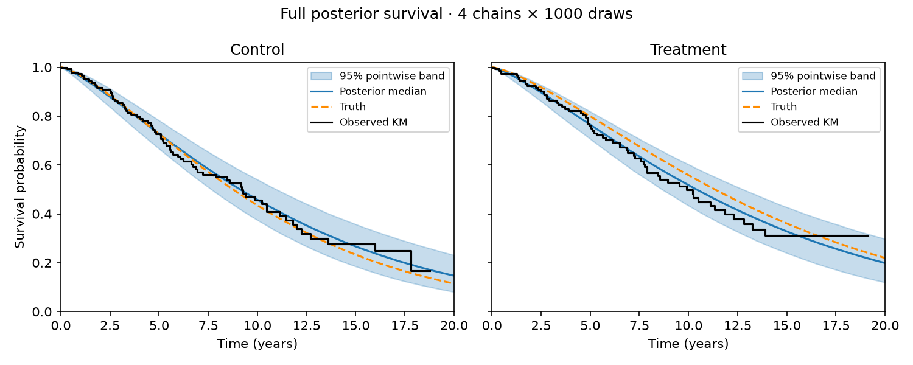
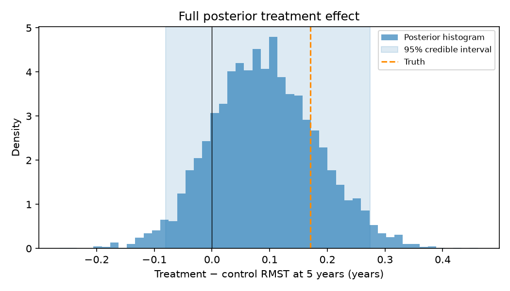
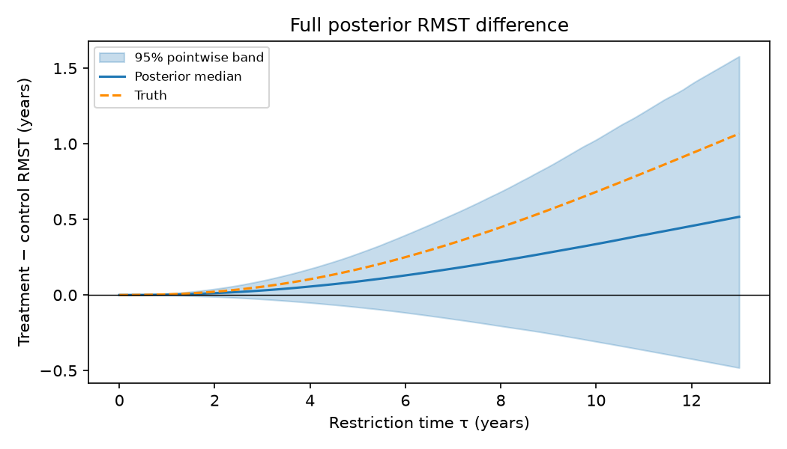
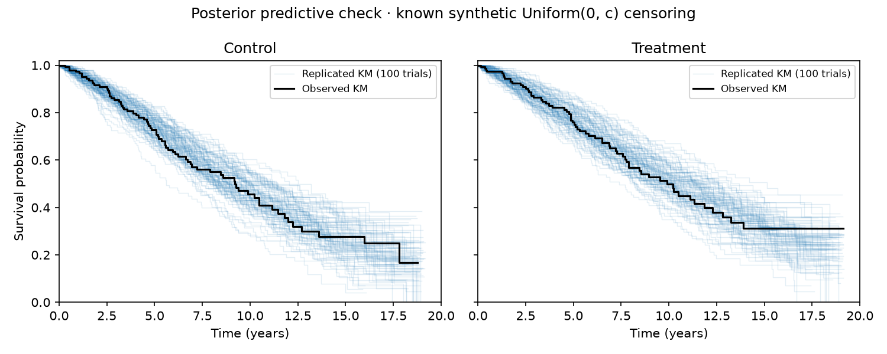

---
jupytext:
  text_representation:
    format_name: myst
kernelspec:
  display_name: Python 3
  name: python3
---

# Bayesian survival and posterior RMST

A survival likelihood can be a NumPyro factor without a distribution adapter.
Here we fit a synthetic two-arm trial, then treat the posterior as a batch of
survival distributions. The treatment effect is the difference in restricted
mean survival time (RMST): expected event-free time accumulated before a
specified horizon. All times on this page are **years**.

The page executes a short **smoke** run during every build. Tables and figures
labelled **recorded full run** come from the committed four-chain run, not
from those short chains. Everything is synthetic; no patient data are used.

## Trial and reproducibility

The trial has 300 subjects, 150 per arm. Its true Weibull shape is 1.38,
control scale 11.42 years, and treatment hazard ratio 0.7. Independent
Uniform(0, c) censoring is calibrated to an expected 55% censored fraction;
the recorded trial has 164/300 censored observations and c ≈ 19.1725 years.

```{code-cell} ipython3
import json
import os
from pathlib import Path
import subprocess
import sys
import tempfile
from IPython.display import HTML, display

repo = next(p for p in (Path.cwd(), *Path.cwd().parents)
            if (p / "examples/bayesian_rmst/run.py").is_file())
results = repo / "examples/bayesian_rmst/results"
full = json.loads((results / "metadata.json").read_text())
child_env = dict(os.environ, JAX_ENABLE_X64="1")
print("Recorded root seed:", full["root_seed"])
print("Recorded censoring limit:", full["censor_limit_years"], "years")
```

Root key 20261025 is folded with 2 for this use case. Separate streams 0, 1,
2 and 3 generate the trial, NUTS, prior curves and predictive trials.
Predictive replicate i folds i into stream 3. The shared generator splits each
supplied key into event and censor keys. Changing the data or seed changes the
experiment; do not reseed to obtain favourable coverage or diagnostics.

## Model and observation plate

The model uses three log parameters. Its current priors are independent
Normal(0, 5) distributions on log shape, log control scale and log hazard
ratio. These are the maintainer's experimental priors, broader than those in
the original use-case sketch. The prior plot below makes their consequences
visible; they are not a recommended default for scientific applications.

The executable model is included directly from the example module:

```{literalinclude} ../../examples/bayesian_rmst/model.py
:language: python
:pyobject: model
```

The `(N,)` likelihood vector stays **inside** the observation plate. Summing it
there would replicate the full-data likelihood N times. A summed factor
outside a plate gives the same full-data target but discards the independence
structure. If minibatching, subset both `data[idx]` and covariates explicitly:
NumPyro owns N/batch scaling; survjax does not scale observations.

The per-arm deterministic RMST sites sit outside the observation plate.
`compute_rmst=False` keeps their work out of NUTS; they are filled afterwards.

## Factor wiring check, executed live

At fixed parameters log k = log(1.2), log b₀ = log(10), gamma = −0.3, the
check requires NumPyro's log density to equal the three prior log densities
plus the summed survjax likelihood, to absolute tolerance 1e-10. It also
checks the factor plate and the deterministic-site shapes.

```{code-cell} ipython3
factor = subprocess.run(
    [sys.executable, "-c",
     "from examples.bayesian_rmst.check_model import check_factor; check_factor()"],
    cwd=repo, env=child_env, capture_output=True, text=True, timeout=90,
)
if factor.returncode:
    raise RuntimeError(factor.stdout + factor.stderr)
print(factor.stdout.strip())
```

The child uses float64 even when the surrounding documentation build tests
float32. This keeps the Bayesian example's precision policy separate from
other examples, without toggling JAX mode in a running kernel.

## Prior predictive survival



There are 200 prior curves **per arm**, with observed KM in black. All draws
are retained. The broad log priors put substantial mass on almost immediate
failure, very long survival and sharp transitions. Tiny shapes can also give
curves near exp(−1) across much of this grid. A diffuse log prior is not a
neutral prior on clinically relevant survival curves. A real application
needs a time scale and prior predictive assessment before fitting.

## Smoke sampling, executed live

The smoke configuration uses four chains, 100 warmup and 100 retained draws
per chain. Its diagnostics are exploratory; the full-run ESS thresholds are
not enforced on the short chains. The runner sets four host devices before
JAX initializes, using parallel chains when available and recording its method.

```{code-cell} ipython3
with tempfile.TemporaryDirectory(prefix="bayes-docs-") as directory:
    destination = Path(directory) / "smoke"
    smoke_process = subprocess.run(
        [sys.executable, "examples/bayesian_rmst/run.py", "--config", "smoke",
         "--output", str(destination)],
        cwd=repo, env=child_env, capture_output=True, text=True, timeout=90,
    )
    if smoke_process.returncode:
        raise RuntimeError(smoke_process.stdout + smoke_process.stderr)
    smoke = json.loads((destination / "metadata.json").read_text())
print("LIVE SMOKE:", smoke["chains"], "chains ×", smoke["draws_per_chain"], "draws")
print("Chain method:", smoke["chain_method"])
print("Divergences per chain:", smoke["divergences_per_chain"])
print("RMST route maximum absolute error:", smoke["rmst_route_max_absolute_error"])
```

## Route A: the posterior is a batch

The main route evaluates each draw before aggregation. With S flattened
posterior draws from `mcmc.get_samples()`, the baseline has batch `(S,1)`
and PH has batch `(S,2)`. The runner supplies these arrays and the grids:

```{literalinclude} ../../examples/bayesian_rmst/model.py
:language: python
:pyobject: posterior_draws
```

The survival grid has 201 points from 0 to 20 years. The 101-point RMST grid
ends at 13 years: the observed-time 90th percentile rounded down to half a
year. The five-year horizon is within that follow-up bound.

## Route B: deterministic sites after sampling

`Predictive(model, posterior_samples=samples)(key, data, arm,
compute_rmst=True, tau=5.0, tau_grid=tau_grid)` fills the model's RMST sites.
Its curve is `(S,m,2)`; align it to route A's `(m,S,2)` before comparing.
The runner requires absolute-only agreement to 1e-12, with finite values.
The recorded full run's maximum difference is about 2.84e-14; the live smoke
cell above reports its independently executed comparison.

Do not evaluate at posterior mean parameters and call that a posterior curve.
Pair the arm effects within each draw before computing differences or bands.

## Recorded full-run figures and table

### Diagnostics and truth

The committed run uses **four chains × (1000 warmup + 1000 retained draws)**,
default NUTS settings and NumPyro's default `init_to_uniform`. It has zero
divergences. All three log parameters and all five reported quantities meet
split R-hat < 1.01, NumPyro ESS > 400 and ArviZ tail ESS > 400. The NumPyro
ESS here is the value from `numpyro.diagnostics.summary`, not a substituted
rank-normalized estimator. Versions and individual metrics are in the record.

```{code-cell} ipython3
assert full["config"] == "full" and full["audit"]["passed"]
labels = {"k": "Shape k", "HR": "Hazard ratio", "RMST0(5)": "Control RMST(5)",
          "RMST1(5)": "Treatment RMST(5)", "delta_RMST(5)": "Difference RMST(5)"}
rows = ["<table><thead><tr>",
        "".join(f"<th>{label}</th>" for label in
                ("Quantity", "Truth", "Mean", "SD", "95% interval", "R-hat", "ESS", "Tail ESS")),
        "</tr></thead><tbody>"]
for key, label in labels.items():
    estimate = full["posterior_table"][key]
    diagnostics = full["audit"]["diagnostics"][key]
    truth = full["audit"]["truth"][key]
    cells = (label, f"{truth:.3f}", f"{estimate['mean']:.3f}", f"{estimate['sd']:.3f}",
             f"[{estimate['lower_95']:.3f}, {estimate['upper_95']:.3f}]",
             f"{diagnostics['r_hat']:.4f}", f"{diagnostics['numpyro_ess']:.0f}",
             f"{diagnostics['tail_ess']:.0f}")
    rows.append("<tr>" + "".join(f"<td>{cell}</td>" for cell in cells) + "</tr>")
display(HTML("".join(rows) + "</tbody></table>"))
print("Recorded full-run P(ΔRMST(5)>0):", full["probability_delta_rmst_positive"])
print("Versions:", full["versions"])
```

RMST means, SDs and intervals are in years. Both HR=0.7 and true
ΔRMST(5)≈0.1702 years lie inside their 95% intervals. This is a sanity check
on one fixed synthetic dataset, not repeated-sampling coverage evidence.
The intervals also include HR=1 and ΔRMST=0: this trial does not determine
the effect precisely, despite its known beneficial data-generating effect.



The shaded areas are 95% **pointwise** credible bands, not simultaneous bands.
Dashed orange curves are the data-generating truth. Black curves are observed
Kaplan–Meier estimates, ending at each arm's last observed follow-up.



The histogram is a normalized posterior density display, with the equal-tail
95% interval shaded and the true effect dashed. Positive values favour
treatment. The recorded posterior probability of a positive difference is
about 0.847; it is conditional on this model, these priors and this dataset.



Differences are computed per draw at every cutoff before taking quantiles.
A wider interval at longer horizons reflects uncertainty in accumulated time;
RMST is zero for both arms at a zero cutoff.

## Posterior predictive check



Each arm shows 100 replicated KM curves under the observed curve. The selected
posterior indices are `floor(i*S/100)`, giving 25 replicates per chain in the
full run. Each trial keeps the observed arm assignment and generates fresh
event and censor times. The original **known synthetic** Uniform(0,c)
censoring process is reused; a real study would need an appropriate censoring
model or design assumptions. No library event-time `.sample()` is used.

The observed curves lie within the replicate cloud over much of follow-up.
This visual comparison can expose gross mismatch; it is not a calibrated
p-value or proof that the model is correct. Late KM jumps are noisy when few
subjects remain at risk. All replicates are shown without selection by fit.

The demo-only KM handles events before censorings tied at the same time. It
was checked once against R 4.4.2, survival 3.7.0, using `survfit(Surv(time,
event) ~ 1)` separately by arm on this exact synthetic trial. At all 150
observed times per arm, maximum survival discrepancies were 4.44e-16 and
5.55e-16. R CSV times were aligned with their original observed times before
step lookup to avoid decimal-rounding at jumps; no probabilities were adjusted.
The estimator lives in `examples.bayesian_rmst.figures`, not the library API.

## Reproduce and inspect

The recorded full-run delivery is under `examples/bayesian_rmst/results/`.
`delivery.json` records source commits and SHA-256 hashes; `metadata.json`
records the full inference audit. The compact `posterior.npz` holds the
synthetic trial, chain-grouped parameters, grids and divergence flags.
Derived curves and replicated trials are regenerated, not stored in Git.
The results README shows how to materialize a renderer-ready directory from
the saved draws without rerunning NUTS. PNG previews are committed for display;
the renderer regenerates both PNG and SVG figures.

From the repository root:

```sh
uv run --group examples examples/bayesian_rmst/run.py --config full --output /tmp/bayes-full
JAX_ENABLE_X64=1 uv run --group examples python -m examples.bayesian_rmst.figures /tmp/bayes-full /tmp/bayes-figures
```

Both destinations must be new directories. Preserve failed-run evidence and
investigate rather than silently retuning or reseeding. These recorded CPU
timings and diagnostic results do not advertise a platform or version matrix.
The core package remains independent of the optional examples dependencies.

## Takeaways

- A row-wise factor inside an observation plate connects survjax to NumPyro.
- Posterior draws form a batch; evaluate each draw before taking summaries.
- Pair treatment and control within each draw for RMST differences.
- Pointwise bands and a plausible predictive cloud do not prove model adequacy.
- Check survival implications of log priors before using them in an application.
