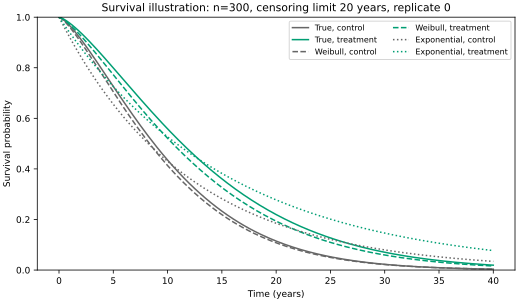
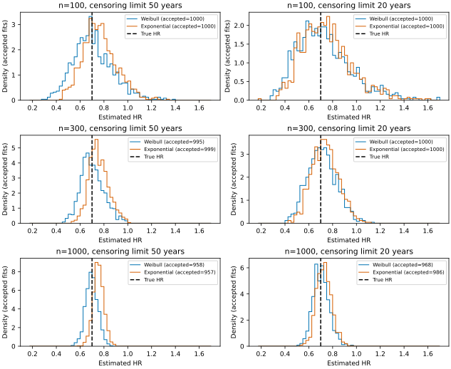
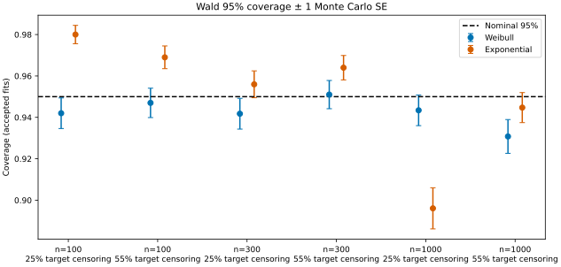

---
jupytext:
  text_representation:
    format_name: myst
kernelspec:
  display_name: Python 3
  name: python3
---

# From survival regression to a simulation study

How does a treatment change the risk of an event, and how precisely can we
estimate that change? In this tutorial we fit a Weibull survival regression
to a simulated two-arm trial and obtain a hazard ratio with a confidence
interval. We then repeat the analysis across many simulated trials to ask
whether those intervals cover the true effect as often as they should.

survjax supplies the survival likelihood. JAX differentiates it to obtain
the derivatives and Hessian needed for fitting and standard errors, and lets us apply
the same analysis to a batch of datasets.
This is useful whenever one fit
becomes many: a simulation study or a bootstrap.

```{code-cell} ipython3
:tags: [remove-input]
import json
import sys
from pathlib import Path
from tempfile import TemporaryDirectory

import jax
jax.config.update("jax_enable_x64", True)
import jax.numpy as jnp
import pandas as pd
import optimistix as optx
import survjax

ROOT = next(p for p in (Path.cwd(), *Path.cwd().parents) if (p / "pyproject.toml").is_file())
sys.path.insert(0, str(ROOT))
from examples.weibull_simulation import run as runner
RESULTS = ROOT / "examples/weibull_simulation/results"
metadata = json.loads((RESULTS / "metadata.json").read_text())
```

## One trial: estimate a treatment effect

Our trial has 300 patients, allocated equally to control and treatment.
We simulate event times from a Weibull proportional hazards model,

$$
S(t\mid x)=\exp\!\left[-(t/b_0)^k e^{\gamma x}\right],
$$

where $x=0$ denotes control and $x=1$ treatment. The baseline scale $b_0$
is measured in years, the shape $k$ describes how the hazard changes over
time, and $e^\gamma$ is the treatment-to-control hazard ratio.
Here $k=1.38$, $b_0=11.42$ years and $e^\gamma=0.7$: treatment lowers the
hazard by 30% at every time.

Some patients remain event-free when follow-up ends. We observe the earlier
of their event and censoring times, together with an indicator of whether
the event occurred. Censoring is independent of event time, with a uniform
censoring times drawn uniformly between 0 and 20 years.

We draw event times by inverting the Weibull survival function,
$T=b_0[-\log(U)/e^{\gamma x}]^{1/k}$, where $U$ is uniform on $(0,1)$.
The observed time is the earlier of the event and censoring times; `event`
records whether the event was observed.

```{code-cell} ipython3
n_patients = 300
arm = jnp.repeat(jnp.array([0., 1.]), n_patients // 2)
censor_limit = 20.0  # years
shape, scale, log_hr = 1.38, 11.42, jnp.log(0.7)

def simulate_trial(key):
    event_key, censor_key = jax.random.split(key)
    u = jax.random.uniform(event_key, shape=(n_patients,))
    event_time = scale * (-jnp.log(u) / jnp.exp(log_hr * arm)) ** (1 / shape)
    censor_time = jax.random.uniform(
        censor_key, shape=(n_patients,), maxval=censor_limit
    )
    time = jnp.minimum(event_time, censor_time)
    event = event_time <= censor_time
    return survjax.SurvivalData(time, event=event)

data = simulate_trial(jax.random.key(20261025))
data.issues.raise_if_invalid()
```

### Obtain the survival likelihood

An observed event contributes its density $f(t)$ to the likelihood; a
censored observation contributes the probability of surviving beyond its
last observed time, $S(t)$. Thus the log likelihood is

$$
\ell(\theta)=\sum_i\left[\delta_i\log f(t_i\mid x_i)
 +(1-\delta_i)\log S(t_i\mid x_i)\right].
$$

We estimate $\theta=(\log k,\log b_0,\gamma)$. Working on the log scale keeps
the shape and scale positive without constraining the optimizer. The
regression enters through the linear predictor `gamma * arm`:

```{code-cell} ipython3
def negative_log_likelihood(theta, data, arm):
    log_k, log_b0, gamma = theta
    baseline = survjax.Weibull.from_log(log_shape=log_k, log_scale=log_b0)
    linear_predictor = gamma * arm
    distribution = survjax.ProportionalHazards(
        baseline, log_hazard_ratio=linear_predictor
    )
    return -distribution.log_likelihood(data).sum()
```

Each patient has their own predicted distribution. `log_likelihood` returns
one contribution per patient, and summing them gives the objective to minimize.
For a regression with several covariates, the same construction uses a design
matrix and `linear_predictor = X @ beta`.

### Fit the model and obtain a confidence interval

We minimize the negative log likelihood with BFGS, using Optimistix. JAX
computes the derivatives of the likelihood automatically.

```{code-cell} ipython3
def fit_one(data):
    def objective(theta, args=None):
        return negative_log_likelihood(theta, data, arm)

    start = jnp.array([0., jnp.log(data.lower.mean()), 0.])
    solution = optx.minimise(
        objective, optx.BFGS(rtol=1e-8, atol=1e-8), start,
        max_steps=1000, throw=False,
    )
    theta = solution.value
    value, gradient = jax.value_and_grad(objective)(theta)
    hessian = jax.hessian(objective)(theta)
    # Retain failed fits in the results, but do not interpret their intervals.
    accepted = (
        (solution.result == optx.RESULTS.successful)
        & jnp.all(jnp.isfinite(theta)) & jnp.isfinite(value)
        & (jnp.max(jnp.abs(gradient)) < 1e-5)
        & jnp.all(jnp.isfinite(jnp.linalg.cholesky(hessian)))
        & jnp.any(data.exact & (arm == 0))
        & jnp.any(data.exact & (arm == 1))
    )
    return theta, hessian, accepted

theta_hat, hessian, accepted = fit_one(data)
assert accepted  # convergence, finite estimates, positive curvature, events in both arms
```

The curvature of the log likelihood tells us how precisely the parameters
are estimated. Let $H$ be the Hessian of the **summed negative log likelihood**
at the estimate. Its inverse estimates the covariance matrix of
$(\log k,\log b_0,\gamma)$; the square roots of the diagonal entries are
standard errors. Inverting the full matrix accounts for estimating the
baseline parameters together with the treatment effect.

```{code-cell} ipython3
covariance = jnp.linalg.solve(hessian, jnp.eye(3))
standard_errors = jnp.sqrt(jnp.diag(covariance))
gamma_hat = theta_hat[-1]
se_gamma = standard_errors[-1]
hr = jnp.exp(gamma_hat)
interval = jnp.exp(gamma_hat + jnp.array([-1.96, 1.96]) * se_gamma)
print(f"Hazard ratio: {hr:.3f}; 95% confidence interval: "
      f"[{interval[0]:.3f}, {interval[1]:.3f}]")
print(f"Log hazard ratio: {gamma_hat:.3f}; standard error: {se_gamma:.3f}")
```

We form the Wald interval on the log hazard ratio scale and exponentiate its
endpoints. These are approximate, model-based intervals: their justification
relies on the model and a sufficiently informative sample. Before interpreting
them, we check convergence, a small gradient and positive likelihood curvature.
A successful optimizer status alone does not establish that the fit is usable.

The fitted survival curves translate the model into probabilities over time.
The saved example below shows another trial with the same model and
20-year censoring limit,
including an Exponential regression, which assumes a constant
baseline hazard. The Weibull model allows the increasing hazard that was actually used to
generate these data.



These curves illustrate the fitted distributions; they have no confidence
bands. One trial cannot tell us whether our confidence interval procedure
works well across repeated samples. That is the next question.

## Many trials: how reliable are the intervals?

Suppose we repeated the trial 1,000 times. How variable would the treatment
effect estimates be? Would approximately 95% of the intervals contain the
true hazard ratio? Would a simpler, but incorrect, Exponential model give
similar answers?

We already have the ingredients for one analysis. The `fit_one` function above
returns the estimates, Hessian and acceptance flag for one trial. `vmap` applies that function across datasets;
`jit` compiles the resulting calculation for repeated use.

```{code-cell} ipython3
n_trials = 20
keys = jax.random.split(jax.random.key(20261026), n_trials)
trials = jax.vmap(simulate_trial)(keys)  # shape: (20 trials, 300 patients)
trials.issues.raise_if_invalid()

fit_many = jax.jit(jax.vmap(fit_one))
estimates, hessians, accepted = fit_many(trials)
jax.block_until_ready(estimates)
print(f"Accepted {int(accepted.sum())} of {n_trials} fits")
```

Here `trials` has shape `(20, 300)`: one row per trial and one column per patient. Each trial
gets its own parameter estimates and Hessian; `arm` is shared because all
trials have the same allocation. The statistical analysis is unchanged by
batching. The first call includes compilation; subsequent calls with the same
array shapes can reuse it. For larger studies, process trials in batches that
fit in memory. Changing the cohort size requires a new compilation.

A bootstrap uses the same pattern: replace the simulated trials with
resampled datasets, keeping each patient's outcome and covariates together.
The intervals studied here remain Hessian-based Wald intervals; we do not
compute bootstrap intervals in this example.

### Compare sample size, censoring and model choice

The full study uses 1,000 trials at each combination of 100, 300 and 1,000
patients and two prespecified censoring limits: 50 and 20 years. Reusing
these limits across sample sizes keeps the expected censoring fractions
comparable; realized fractions vary between
trials. Each trial is fitted with both models using `study.fit_replicate`,
which extends the displayed fitter with standard errors, intervals and
individual failure flags, and skips fitting when an arm has no events. Coverage is the proportion of accepted intervals containing the true
hazard ratio, 0.7. Bias and standard errors below are on the log hazard ratio
scale. Monte Carlo standard errors describe uncertainty from using a finite
number of simulated trials.

```{code-cell} ipython3
:tags: [remove-input]
full = pd.read_csv(RESULTS / "performance.csv")
table = pd.DataFrame({
    "Patients": full.n, "Censoring limit (years)": full.censor_limit.astype(int),
    "Censored": full.realized_censoring.map(lambda x: f"{x:.0%}"),
    "Model": full.model.str.capitalize(), "Accepted": full.accepted, "Failed": full.failed,
    "Bias": full.bias.round(3), "Empirical SE": full.empirical_se.round(3),
    "Model SE (RMS)": full.model_se.round(3),
    "Coverage (MCSE)": [f"{100*p:.1f}% ({100*s:.1f} pp)" for p, s in zip(full.coverage, full.coverage_mcse)],
})
table
```

These are the committed full-run results, not estimates from the live batch.
The empirical SE is the standard deviation of the estimates; the model SE
is the root mean square of their reported standard errors.



The Weibull estimates concentrate around the true effect as sample size grows.
The Exponential estimates remain shifted towards a hazard ratio of one.
Larger samples reduce sampling variation, but do not remove the bias from
assuming the wrong baseline hazard.



At 1,000 patients with a 50-year censoring limit (about 24% censored),
coverage is 89% for Exponential and 94% for Weibull. With a 20-year limit
(about 53% censored), both are approximately 94%. Misspecification affects both the estimates and their reported
uncertainty, so coverage alone does not describe its consequences.

All summaries use accepted fits. Of 12,000 attempted fits, 137 were rejected
because their maximum absolute gradient exceeded the prespecified $10^{-5}$
threshold, despite successful solver status. The table retains these failures;
coverage therefore describes the accepted fits.

### How long does repeated fitting take?

The recorded timings below cover 2,000 Weibull fits with 300 patients each,
including their Hessians and diagnostics. The first call includes compilation;
the warm time is the median of three subsequent calls. Data generation and
result summaries are excluded.

```{code-cell} ipython3
:tags: [remove-input]
timing = full[(full.n == 300) & (full.model == "weibull")].iloc[0]
print(f"First call: {timing.first_call_seconds:.2f} s; warm: {timing.warm_seconds:.2f} s")
print(metadata["runtime"]["cpu_model"])
print("JAX", metadata["runtime"]["packages"]["jax"], "— CPU, float64")
```

## Reproduce

This page executes the single fit and a small batch in float64. It also runs
the study's smoke configuration (20 trials at each censoring level, both
models) below. The figures and full table come from the saved 1,000-trial
study; rebuilding the page does not rerun that study.

```{code-cell} ipython3
:tags: [remove-input]
with TemporaryDirectory(prefix="survjax-weibull-docs-") as folder:
    runner.run_config("smoke", Path(folder))
    smoke = pd.read_csv(Path(folder) / "performance.csv")
print(f"Smoke run completed: {int(smoke.attempted.sum())} fits across both models and censoring levels.")
```

To repeat the full study from the repository root, writing into a new directory:

```bash
uv run --locked --group examples python examples/weibull_simulation/run.py \
  --config full --out /tmp/survjax-weibull-full
```

The saved [performance table](../../examples/weibull_simulation/results/performance.csv) includes bias, precision,
coverage and power with Monte Carlo errors. The [run metadata](../../examples/weibull_simulation/results/metadata.json)
records seeds, censoring limits, versions and timings; the
[failure ledger](../../examples/weibull_simulation/results/failures.csv) retains rejected fits. All data are synthetic.
